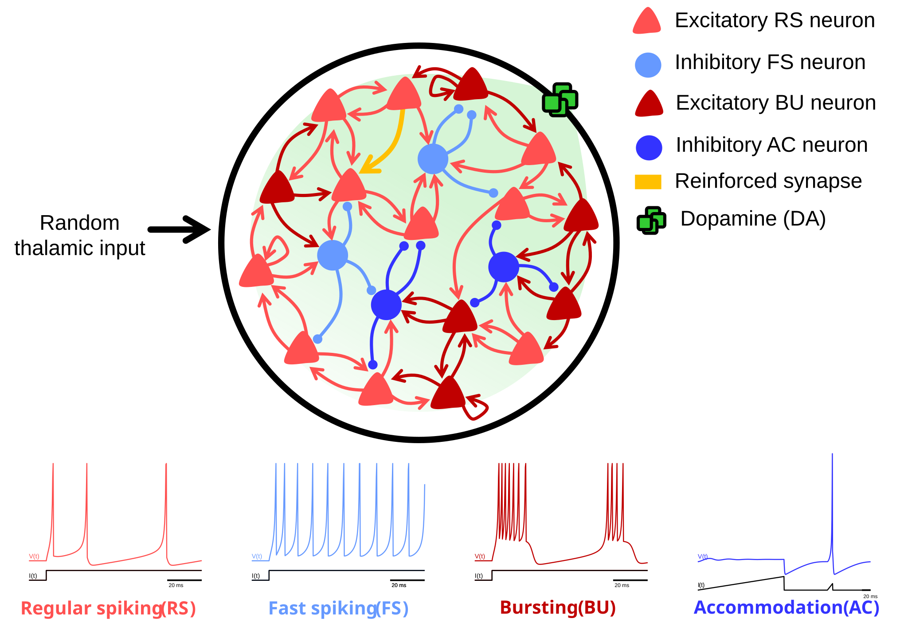

# heterogeneous-izhikevich

## Spiking neural network of Izhikevich neurons with DA-STDP learning.

This project implements a task based on Izhikevich (2007) to reinforce the firing activity of two specific neurons in response to delayed rewards. The network uses dopamine-modulated spike-timing-dependent plasticity (DA-STDP) to strengthen synaptic connections.

We simulate a minimal spiking network where the contingent firing of two neurons is reinforced by a delayed reward, illustrating how dopamine-modulated STDP provides a synaptic-level solution to the credit assignment problem. This simple setup, motivated by the in vivo monkey experiment of Ahissar et al. (1992) and following Izhikevich’s simulations (2007), captures the essential mechanism: synaptic strength (or task performance) is tracked over time, where initially the network receives unexpected rewards without knowing their cause, but through repeated reinforcement the responsible synapse is potentiated until it reaches a maximal value of 4 mV.  

We now aim to extend this framework to investigate how different spiking populations shape learning. By varying the balance of inhibitory and excitatory cell types, we can examine how network heterogeneity influences reinforcement, synaptic competition, and stability under delayed reward signals. This provides a simple pleriminary model for understanding the role of circuit diversity in neuromodulated STDP learning rules.

The network consists of 1000 neurons with 100 connections per neuron and a 4:1 excitatory-to-inhibitory ratio. It includes diverse spiking populations modeled with Izhikevich neurons, featuring regular spiking (RS), fast spiking (FS), bursting (BU), and accommodation (AC) behaviors. These populations are defined by varying *a, b, c, d* parameters.

Rewards are delivered 1–3 seconds after pre- and post-synaptic spikes align within a 20 ms window. Dopamine released upon reward enhances synaptic strengths through DA-STDP, reinforcing the desired activity.

This repository includes an analysis of how the proportions of different neuron types affect learning dynamics. Details are provided in the accompanying [PDF presentation](251024-results.pdf).

## Reference
- Ahissar, E., Vaadia, E., Ahissar, M., Bergman, H., Arieli, A., & Abeles, M. (1992). *Hebbian plasticity in the cortex of the adult monkey depends on the behavioral context.* Science, 257(5072), 1412–1415.
- Eugene M. Izhikevich, *Solving the Distal Reward Problem through Linkage of STDP and Dopamine Signaling*, Cerebral Cortex, Volume 17, Issue 10, October 2007, Pages 2443–2452.

